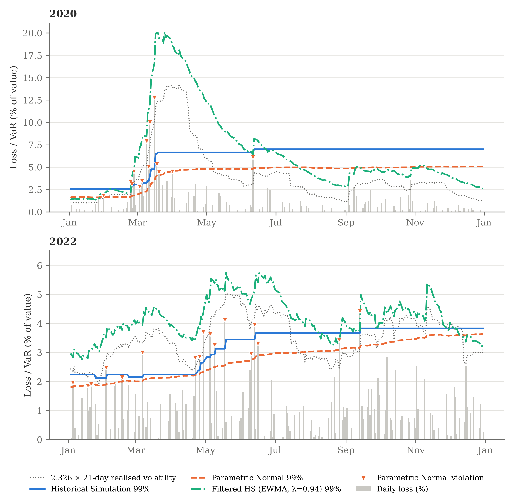
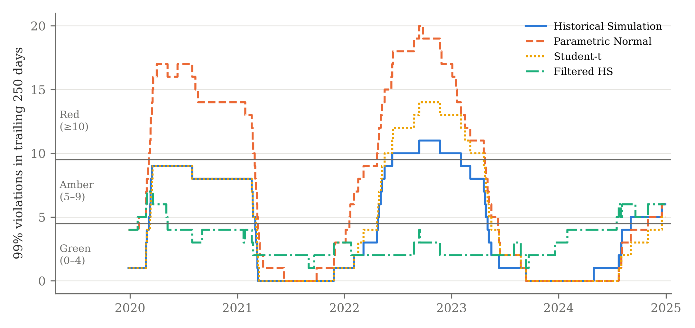
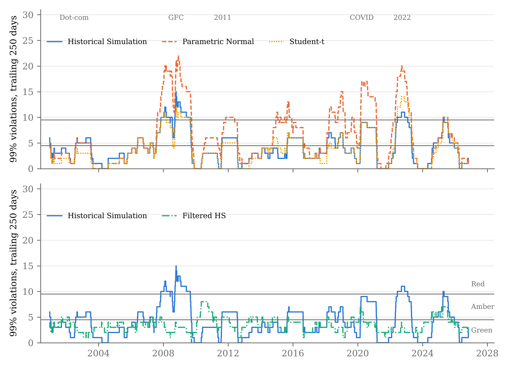

<div align="center">

# Backtesting Value-at-Risk Models Under SR 11-7

*A walk-forward backtest of Historical Simulation, Parametric Normal and Student-t VaR on S&P 500 returns,*  
*benchmarked against conditional models, with finite-sample and estimation-risk corrections and a 2000–2026 robustness sample.*

[](https://python.org)
[](https://numpy.org)
[](https://pandas.pydata.org)
[](https://scipy.org)
[](LICENSE)

**Author:** Niraj Neupane, CA (ICAI) · Quantitative Developer & Founder, Korvane & Calderyn Institute  
**Status:** Revised version under journal review (November 2026)

</div>

---

> **Revision note (November 2026).** The analysis in this repository was substantially extended during peer review.
> Several conclusions of the July 2026 working paper (`Neupane_2026_Backtesting_VaR_SR11-7.pdf`) have been
> **revised or withdrawn** in light of new evidence; see [What changed](#what-changed-since-the-july-2026-working-paper).
> The `code/` folder reproduces every result of the revised version. The original notebook (`Data_python.ipynb`)
> is kept unchanged for reference.

---

## Summary

Three VaR models — Historical Simulation (HS), Parametric Normal and Student-t — are re-estimated **daily on an
equally weighted 250-day window** and evaluated on the next day's S&P 500 log return: **1,509 out-of-sample
forecasts** (January 2019 – December 2024). They are compared, on identical data and windows, with three
**conditional benchmarks**: EWMA-Normal, **filtered historical simulation (FHS)** and GARCH(1,1)-t.

Adequacy is assessed with the Kupiec, Christoffersen and Christoffersen–Pelletier duration tests (with Monte Carlo
p-values), a simulation of estimation risk for this exact design, and the regulatory traffic-light test under both
the US market risk rule (12 CFR 217.204) and Basel MAR32. A robustness sample re-runs everything over
**January 2000 – October 2026 (6,748 forecasts)**.

### Main findings

| # | Finding | Evidence |
|:-:|:---|:---|
| 1 | All three equally weighted models fail 99% unconditional coverage; the Normal model by far the most (44 violations vs 15.1 expected). | Kupiec; HS rejection survives the estimation-risk correction (simulated p ≈ 0.02–0.03) |
| 2 | Violation clustering is present in **every** equally weighted model, at both confidence levels. | Duration test rejects all six model–confidence combinations (MC p < 0.001) |
| 3 | The clustering comes from **equal weighting within the window**, not from rolling-window estimation or tail shape. | FHS, EWMA-Normal and GARCH-t show no significant clustering on the same data; FHS passes every test in 2019–2024 |
| 4 | Estimation risk materially distorts the Kupiec test. | With linear-interpolation quantiles a *correct* HS model is rejected ~12% of the time at nominal 5% |
| 5 | A single 250-day traffic-light window is weak evidence. | All six models — including the conditional benchmarks — are Amber in 2024; a correct model is Amber or worse ~11% of the time |
| 6 | Over 2000–2026 the conclusions hold, and **abrupt crashes, not gradual declines**, produce the largest violation excesses. | Equally weighted models fail every independence/duration test; FHS never enters the Red zone in 6,499 rolling windows |

---

## What changed since the July 2026 working paper

| July 2026 working paper | Revised version |
|:---|:---|
| Clustering is "baked into fixed-window VaR estimation". | **Withdrawn.** Conditional benchmarks on the same window remove it; the cause is equal weighting. |
| The gradual 2022 regime shift caused more excess violations than the COVID crash. | **Withdrawn.** The 2020 vs 2022 counts are not statistically different (Fisher p = 0.28–0.64), and across six episodes since 2000 abrupt crashes produce the larger excesses. |
| Student-t passes independence at 99% (p = 0.107). | **Reversed.** Monte Carlo p = 0.042; the duration test rejects (p < 0.001). |
| None of the models reach the Green zone in 2024. | **Reframed.** True, but so do the conditional benchmarks; the rolling zone distribution is reported instead. |
| Basel multipliers 3.00–4.00, zones Green/Yellow/Red, cited to BCBS (2019). | **Corrected.** 3.00–4.00 is the US market risk rule (12 CFR 217.204); Basel MAR32.9 uses 1.50 / 1.70–1.92 / 2.00 with Green/Amber/Red. Both are reported. |
| Student-t VaR described with a standardised t quantile and σ. | **Corrected.** The estimator is a location–scale t (unrestricted MLE); the fitted ν is ≤ 2 in 19% of windows (82% in 2020). |
| Student-t 95% count 88. | 89 with the current code (optimiser-sensitive; no conclusion changes). |
| Static backtests "tell a different story" (asserted). | **Now shown** (static-calibration comparison). |

---

## Repository contents

| Path | Description |
|:---|:---|
| `code/` | Python pipeline reproducing every table and figure of the revised version |
| `data/sp500_close_2018_2024.csv` | S&P 500 closes, 2 Jan 2018 – 30 Dec 2024 (1,760 closes → 1,759 log returns) |
| `data/sp500_close_1999_2026.csv` | S&P 500 closes, 31 Dec 1998 – 30 Oct 2026 (robustness sample) |
| `results/revision/` | Output tables (CSV/JSON), run logs and figures of the revised analysis |
| `Data_S&P500.csv` | Original data file (prices and log returns, 3 Jan 2018 – 30 Dec 2024); identical to `data/sp500_close_2018_2024.csv` on all 1,759 days |
| `Data_python.ipynb`, `Code.html` | Original July 2026 notebook and its rendered output |
| `Neupane_2026_Backtesting_VaR_SR11-7.pdf / .docx` | July 2026 working paper (superseded; see revision note) |
| `results/0*.png` | Charts from the July 2026 working paper |

---

## Reproducing the results

```bash
pip install -r requirements.txt
cd code
mkdir -p out
python replicate.py    # descriptive statistics, base models, Kupiec and Christoffersen     (~1 min)
python analysis.py     # conditional benchmarks, MC p-values, duration tests, Fisher tests,
                       # subperiod clustering, rolling zones, static calibration, Holm      (~5 min)
python sim_size.py     # estimation-risk simulation of the walk-forward design             (~20 s)
python figures.py      # Figures 1–2
python robust.py       # robustness sample, Jan 2000 – Oct 2026                            (~8 min)
python sim_long.py     # estimation-risk simulation for the robustness sample
python fig3.py         # Figure 3
```

Outputs are written to `code/out/`; the reference outputs are in `results/revision/`. Random seeds are fixed.

**Conventions.** HS uses the linear-interpolation empirical quantile (NumPy default; Hyndman–Fan type 7).
The Normal model uses the sample mean and standard deviation (ddof = 1). The Student-t model is a location–scale t
fitted by unrestricted maximum likelihood (`scipy.stats.t.fit`). EWMA and FHS use λ = 0.94 (RiskMetrics, not tuned),
initialised at the variance of the first 250 returns. GARCH(1,1)-t is re-estimated daily on the trailing 250 returns
with the `arch` package. Every forecast uses information up to t − 1 only.

---

## Key results (2019–2024, 99% VaR)

| Model | Violations (15.1 exp.) | Kupiec p | Consecutive pairs | Independence MC p | Duration MC p |
|:---|:---:|:---:|:---:|:---:|:---:|
| Historical Simulation | 26 | 0.010 | 3 | 0.004 | <0.001 |
| Parametric Normal | 44 | <0.001 | 4 | 0.023 | <0.001 |
| Student-t | 28 | 0.003 | 2 | 0.042 | <0.001 |
| EWMA-Normal | 37 | <0.001 | 1 | 0.931 | 0.166 |
| **Filtered HS** | **22** | **0.094** | **0** | **0.530** | **0.956** |
| GARCH(1,1)-t | 29 | 0.001 | 0 | 0.361 | 0.366 |



*99% VaR for HS, Normal and FHS against realised volatility and losses. In both years the equally weighted
models lag; FHS does not.*

### Regulatory traffic-light test

| Violations (250 days, 99%) | Zone | US rule (12 CFR 217.204) | Basel MAR32.9 |
|:---:|:---:|:---:|:---:|
| 0–4 | 🟢 Green | 3.00 | 1.50 |
| 5–9 | 🟠 Amber | 3.40–3.85 | 1.70–1.92 |
| ≥ 10 | 🔴 Red | 4.00 | 2.00 |



---

## Robustness: January 2000 – October 2026

| Model (99%) | Violations (67.5 exp.) | Kupiec p | Duration MC p | % of windows Red |
|:---|:---:|:---:|:---:|:---:|
| Historical Simulation | 113 | <0.001 | ≤0.001 | 9.0 |
| Parametric Normal | 168 | <0.001 | ≤0.001 | 25.2 |
| Student-t | 104 | <0.001 | ≤0.001 | 8.4 |
| EWMA-Normal | 148 | <0.001 | 0.013 | 9.5 |
| **Filtered HS** | **94** | 0.002 | **0.973** | **0.0** |
| GARCH(1,1)-t | 127 | <0.001 | 0.578 | 2.6 |

FHS's 94 violations match the ~92 that estimation risk alone produces for a correctly specified model using this
quantile convention (simulated p = 0.32–0.39). At 99% FHS still fails the first-order Markov independence test
(six consecutive-violation pairs in 26 years), because the EWMA filter reacts to a shock only on the next day.



---

## SR 11-7 / SR 26-2 implications

- Document the Parametric Normal failure at 99% — it is far beyond what estimation risk can produce.
- Treat a simple conditional model (e.g. FHS) as the **minimum challenger** before attributing failures to tail shape.
- Report finite-sample evidence: state the quantile convention, use simulated critical values, Monte Carlo or duration-based p-values, and rolling traffic-light distributions rather than a single window.
- Treat calendar-year violation comparisons as descriptive unless formally tested.
- SR 26-2 (April 2026) retains outcomes analysis and independent validation while scaling oversight to materiality; for capital models these findings remain central.

---

## Related work

- **ML-LiqVaR** — a liquidity- and regime-aware gradient-boosting VaR model: [github.com/nirajneupane17/ml-liqvar](https://github.com/nirajneupane17/ml-liqvar). Any such model should be required to improve on filtered historical simulation under the same walk-forward design and tests.

---

## Citation

```bibtex
@misc{neupane2026var,
  author = {Neupane, Niraj},
  title  = {Backtesting Value-at-Risk Models: A Walk-Forward Analysis of Coverage,
            Independence, and Regulatory Traffic-Light Tests},
  year   = {2026},
  note   = {Working paper, revised November 2026},
  url    = {https://github.com/nirajneupane17/VaR-Backtesting-SR11-7}
}
```

---

## Key references

- Barone-Adesi, G., Giannopoulos, K., & Vosper, L. (1999). VaR without correlations for portfolios of derivative securities. *Journal of Futures Markets*, 19(5), 583–602.
- Basel Committee on Banking Supervision (2019). *Minimum capital requirements for market risk* (MAR32).
- Christoffersen, P. F. (1998). Evaluating interval forecasts. *International Economic Review*, 39(4), 841–862.
- Christoffersen, P., & Pelletier, D. (2004). Backtesting value-at-risk: a duration-based approach. *Journal of Financial Econometrics*, 2(1), 84–108.
- Escanciano, J. C., & Olmo, J. (2010). Backtesting parametric value-at-risk with estimation risk. *Journal of Business & Economic Statistics*, 28(1), 36–51.
- Kuester, K., Mittnik, S., & Paolella, M. S. (2006). Value-at-risk prediction: a comparison of alternative strategies. *Journal of Financial Econometrics*, 4(1), 53–89.
- Kupiec, P. H. (1995). Techniques for verifying the accuracy of risk measurement models. *Journal of Derivatives*, 3(2), 73–84.
- Federal Reserve (2011). *Supervisory guidance on model risk management* (SR 11-7); Federal Reserve, OCC & FDIC (2026). *Revised guidance on model risk management* (SR 26-2).
- 12 CFR 217.204 — Measure for market risk (US market risk rule).

---

<div align="center">

**Niraj Neupane**  
Quantitative Developer · Founder, Korvane & Calderyn Institute  
MS Financial Economics · University of Wisconsin–Madison · Chartered Accountant (ICAI)

[github.com/nirajneupane17](https://github.com/nirajneupane17)

*Built with Python · NumPy · Pandas · SciPy · arch · Matplotlib*

</div>
